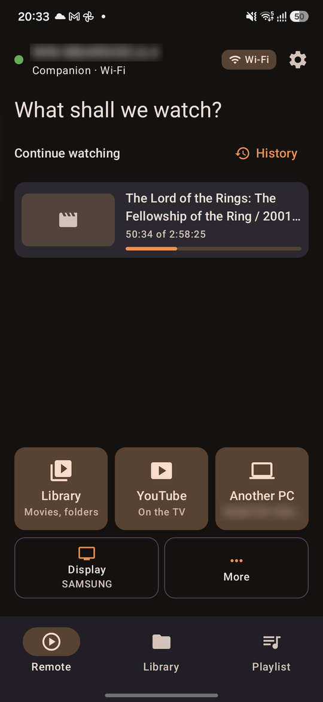
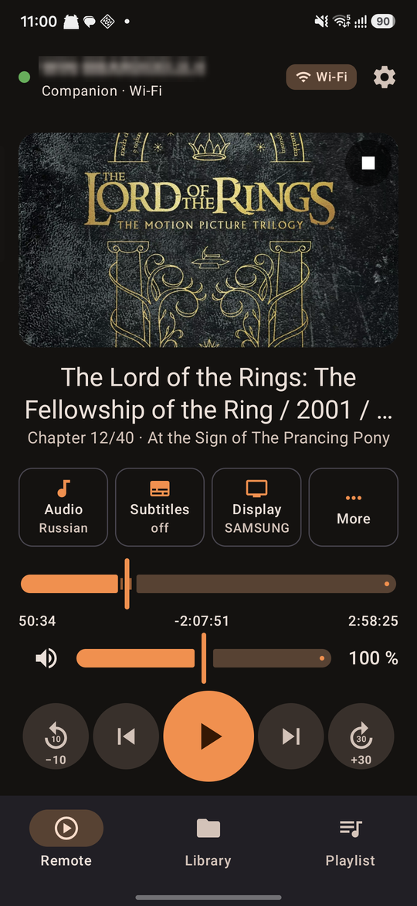
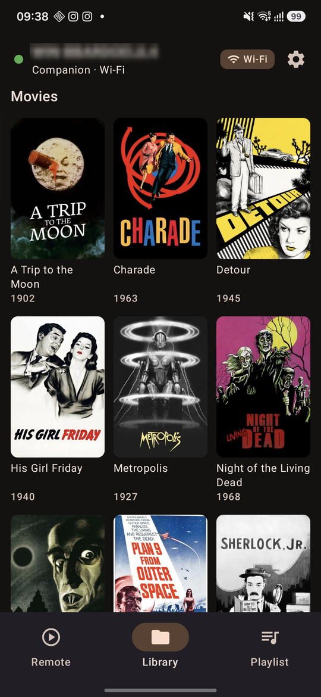
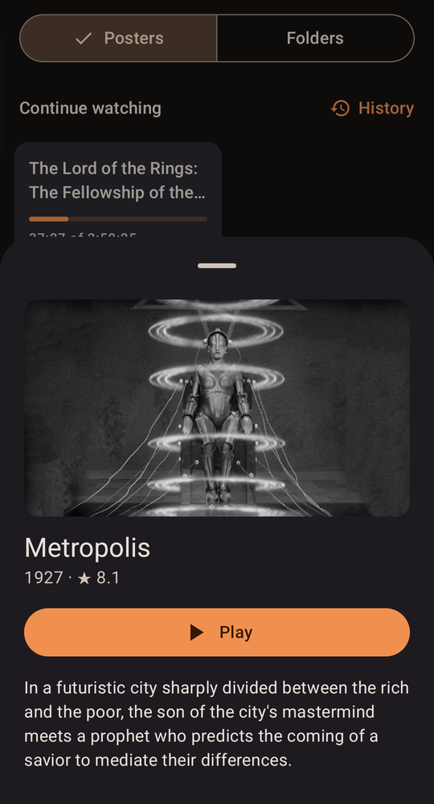
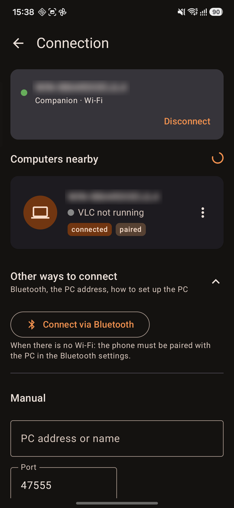
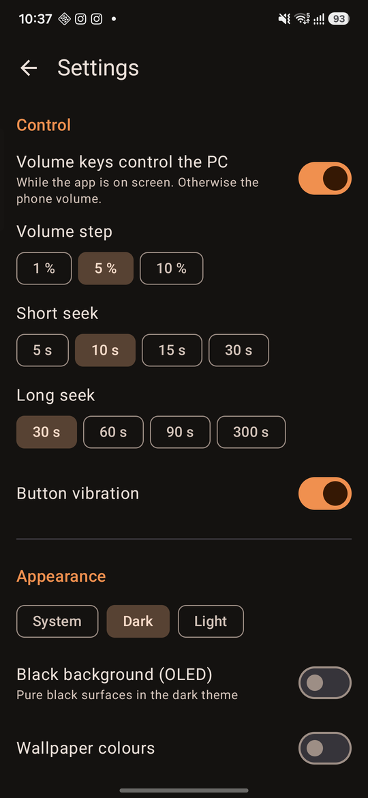

# Sofabird

Sofabird turns a Windows PC or laptop connected to a TV into a media station you run from the couch with your
Android phone: an Android remote for [VLC media player](https://www.videolan.org/vlc/) plus a small Windows companion,
which also puts YouTube videos and a [Moonlight](https://moonlight-stream.org/) stream of another computer on the TV.
Formerly called *VLC Remote*.

[](https://github.com/lex019020/sofabird/actions/workflows/ci.yml)
[](https://github.com/lex019020/sofabird/releases)

<p align="center">
  
  
  
  
</p>
<p align="center">
  
  
  
</p>

**Website:** [sofabird.app](https://sofabird.app/) ·
**Download:** [latest release](https://github.com/lex019020/sofabird/releases/latest)

The phone controls VLC through the companion on the PC (Sofabird for Windows): it finds the PC by itself, starts VLC
on the TV, keeps working over Bluetooth when Wi‑Fi is gone and remembers where you stopped watching. The apps follow
the system language: English and Russian.

## What it can do

**On the phone**
- Play/pause, seek with ±10/30 s buttons (hold to repeat) and a scrub bar with chapter marks, volume, chapters,
  playback speed, aspect ratio, fullscreen; the phone's volume keys control the PC.
- Audio and subtitle tracks with their languages, audio/subtitle delay.
- Browse the PC's drives and network shares, favourite folders, play or enqueue; playlist with swipe to remove.
- "Continue watching" and a watch history: resume where you stopped, mark as watched, the next episode of a series;
  YouTube videos played on the TV are there too.
- When nothing is on the TV, the remote opens on "What shall we watch?": continue watching (with TMDB stills and
  YouTube thumbnails), the Library, YouTube and another PC's screen.
- A media notification with lock-screen controls while a movie plays.
- A sleep timer: pause the TV after 15 min … 2 h or at the end of the episode, and put the PC to sleep if you like.
- The phone as the PC's touchpad and keyboard: by itself while a Moonlight stream is on the TV, and any time from
  "More" — move the pointer, tap to click, two fingers to scroll or right-click, hold to drag; type in any language
  (the text goes over as you type), plus Esc, Tab, Win and the arrows.
- Updates itself from GitHub Releases: test builds or releases only (Android asks you to confirm each update).

**On the PC (the companion)**
- Automatic discovery and one-time pairing with a 6-digit code shown on the TV; the connection is encrypted (TLS,
  the PC's certificate is pinned when the phone pairs).
- A media library: pick the media folders once, and the phone shows movies and series as posters with
  descriptions, ratings, seasons and episodes (metadata from TMDB). Network shares work too: the companion does not
  wake the computer they are on every half hour, and a folder that cannot be reached is named on the phone.
- Starts VLC with the right settings and puts its window fullscreen on the TV; choose the TV and the audio device
  (speakers / TV / headphones) from the phone.
- Bluetooth fallback: the remote keeps working with Wi‑Fi off and switches back when it returns.
- Wake-on-LAN: when the PC sleeps, "Wake up the PC" on the phone wakes it over the network (the setup window turns it
  on; it needs a network card that can wake the PC from sleep — usually a desktop's over a cable — and the setup window
  says when the PC's cannot).
- YouTube on the TV: share a video to Sofabird from the YouTube app (or paste a link) and it plays fullscreen on the
  TV in Firefox, with a TV profile of its own you sign in to once. A small Sofabird extension in that browser gives
  exact control: precise seeking, fullscreen after the ads, "Skip" for an ad as soon as YouTube allows it. The remote,
  the phone's notification, lock screen and volume keys control it, and a movie started from the phone closes it.
  Ads can be blocked with uBlock Origin and sponsor segments skipped with SponsorBlock (a switch each, on the phone
  or in the setup window); the setup window installs Firefox and opens the YouTube sign-in.
- One TV screen: the display chosen on the phone (or in the tray) is where VLC, YouTube and Moonlight open; choosing
  it moves whatever is on the TV.
- Another PC's screen: start and end a [Moonlight](https://moonlight-stream.org/) stream of a gaming PC's desktop on
  the TV (Moonlight and Sunshine are installed separately); meanwhile the remote is that computer's touchpad and
  keyboard.
- PC controls: system volume, turn the screen off, sleep, "keep awake during a movie".
- Media station mode: the laptop keeps working with the lid closed, survives the TV being switched off and on
  (VLC pauses and comes back fullscreen on the TV).
- A setup window for the firewall, autostart and VLC, and quiet automatic updates.

## Install

Everything is on the [Releases](https://github.com/lex019020/sofabird/releases) page. Every merge to `main`
publishes a test build; releases are published from time to time.

1. **PC:** download and run `Sofabird-Setup.exe`. It installs for the current user (the .NET 10
   runtime is added when missing, with one administrator prompt), opens the setup window — allow the firewall rules
   there — and then keeps itself up to date. VLC media player must be installed (3.0.x).
2. **Phone (Android 8+):** install `Sofabird-<version>.apk` from the same release. After that the app offers its
   own updates (Settings → "Updates": test builds or releases only); Android asks you to confirm each one.
3. Open the app: it finds the PC, the PC shows a code on the TV, enter it on the phone. Done.

The phone app needs the companion: it no longer talks to VLC's web interface directly (that mode was removed in 0.5).

<details>
<summary>Installing with scripts (also installs VLC and puts the APK on a phone via adb)</summary>

```powershell
$d = "$env:TEMP\sofabird"; New-Item -ItemType Directory -Force $d | Out-Null
$tag = @(Invoke-RestMethod 'https://api.github.com/repos/lex019020/sofabird/releases?per_page=1')[0].tag_name
'deploy-lib.ps1', 'deploy-windows.ps1', 'deploy-android.ps1' | ForEach-Object {
    Invoke-WebRequest "https://github.com/lex019020/sofabird/releases/download/$tag/$_" -OutFile "$d\$_" -UseBasicParsing }
& $d\deploy-windows.ps1 -Firewall -Autostart   # the companion on this PC
& $d\deploy-android.ps1                         # the app on an allowed phone via adb (see CLAUDE.md)
```

No GitHub account is needed. From a working copy: `scripts\deploy-windows.ps1`, `scripts\deploy-android.ps1`
(`-Local` builds from source); all switches are in [CLAUDE.md](CLAUDE.md).
</details>

## Repository

| Folder | What it is |
|---|---|
| [`android/`](android/README.md) | Android app: Kotlin, Jetpack Compose, modules `:app` and `:core:protocol` |
| [`companion/`](companion/README.md) | Windows companion: .NET 10 tray app (WebSocket / UDP / DNS-SD / Bluetooth RFCOMM, VLC manager) |
| [`companion/lua/`](companion/lua) | Lua pages for VLC's HTTP interface (`tracks.json`, `setvar.json`) |
| [`protocol/`](protocol/README.md) | The phone ↔ companion protocol (v1) and VLC's HTTP interface with its quirks |
| [`docs/`](docs/PLAN.md) | Plan, architecture decisions (ADRs), research and live VLC measurements |
| [`scripts/`](scripts) | Install / deploy scripts, release notes, remote debugging of the TV laptop |

## Building

```powershell
# Companion (.NET SDK 10)
dotnet build companion\Sofabird.sln -c Release
dotnet test  companion\Sofabird.sln

# Android (JDK 17/21, Android SDK 35)
android\gradlew.bat -p android detekt test :app:assembleDebug
android\gradlew.bat -p android :app:verifyRoborazziDebug   # screenshot tests of the screens
```

CI builds and tests every pull request and checks its title and release notes; merges to `main` produce test
builds. Conventions for code, pull requests, versions and releases are in [CLAUDE.md](CLAUDE.md).

## Roadmap

In 0.4.0: the app updates itself, a YouTube history, Wake-on-LAN, an encrypted connection and the home screen. In 0.5 so far: a sleep timer; 0.5 also drops the unencrypted connection. Later: a Quick Settings tile, widgets, Wear OS, subtitle download, VLC 4. The full plan is in [docs/PLAN.md](docs/PLAN.md).

## License

Copyright (C) 2026 lex019020

Sofabird is free software: you can redistribute it and/or modify it under the terms of the
[GNU General Public License](LICENSE) as published by the Free Software Foundation, either version 3 of the License,
or (at your option) any later version. It is distributed in the hope that it will be useful, but WITHOUT ANY
WARRANTY; without even the implied warranty of MERCHANTABILITY or FITNESS FOR A PARTICULAR PURPOSE.

Third-party libraries keep their own licenses (MIT / Apache-2.0). Movie and series metadata and images come from
[TMDB](https://www.themoviedb.org/): this product uses the TMDB API but is not endorsed or certified by TMDB.
VLC is a trademark of VideoLAN; YouTube is a trademark of Google LLC; Firefox is a trademark of the Mozilla
Foundation. This project is not affiliated with VideoLAN, Google, Mozilla or the Moonlight project.
